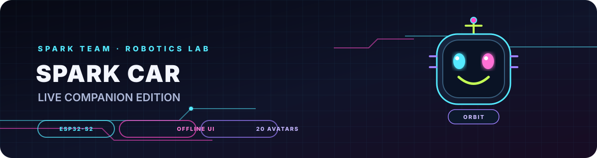

# Changelog

## Cinematic Companion Stories (2026-10-27)
- Added a floating story stage with character performer, timed scenes, animated mini-piano, piano keys, moving hands, music notes, and story captions.
- PICO gets a wake-and-waddle welcome and autonomous singing/whistling/clumsy/sleepy stories.
- BEEP gets a confident piano introduction, a synchronized pleasant melody, an intentionally bad second phrase, and an embarrassed hide-the-face ending.
- Added a scroll-while-speaking detector: repeated scrolling during a spoken line interrupts the voice and triggers a grumpy reaction.
- Removed the large companion speech strip and filtered routine success toasts so direction changes do not fill the screen with status messages.
- Kept companion behavior in the browser, separate from motor control routes.
- Audio still follows browser autoplay rules; a user gesture is required to unlock it.

<div align="center">
  

  <h1>SPARK CAR — Live Companion Edition</h1>
  <p><strong>An offline-first ESP32-S2 robot car with a neon control portal, 20 original robot avatars, eight browser-generated sound effects, and an always-on floating mini-companion.</strong></p>

  <p>
    
    
    
    
  </p>
  <p><a href="docs/index.html">Open interactive browser preview</a> · <a href="SOUND_AND_PERSONALITY.md">Sound & Personality</a> · <a href="CyberCar_SPARK_CAR/LIVE_COMPANION_GUIDE.md">Live Companion guide</a> · <a href="WIRING.md">Wiring guide</a></p>
</div>

> [!WARNING]
> **Prototype hardware — use a physical battery disconnect.** Test with the drive wheels lifted clear of the table first. This is a hobby robotics project, not a safety-certified vehicle controller. Software stop/brake commands are not a substitute for electrical isolation.

## 1. Project at a glance

**SPARK CAR** is a locally controlled robot-car project built around an ESP32-S2 Mini and an L298N dual H-bridge motor-driver module. The ESP32 creates its own Wi-Fi access point and serves a responsive dashboard directly from flash. A phone or laptop connects to that access point and controls the car without a home router, cloud account, or Internet connection.

The dashboard includes a selectable main vector avatar plus a separate floating companion that can switch independently between all 20 characters. Every character has its own personality profile, random reactions, sound timbre, and beep style. Browser-generated sounds are separate from the physical buzzer attached to the car.

### Implementation status

| Capability | Status in this release |
|---|---|
| ESP32-S2 access point and embedded portal | Implemented; phone OS captive-window behavior varies by device |
| Manual forward / backward / left / right / stop | Implemented with hold-to-drive buttons and a firmware timeout |
| Servo angle control | Implemented, target range 0–180°; physical speed depends on the servo |
| Hardware horn/buzzer route | Implemented on configured `BUZZER_PIN`; verify the actual buzzer wiring |
| 20 original robot faces | Implemented as inline SVG; no photo files or remote image requests required |
| Live companion reactions | Implemented as lightweight CSS/SVG animations; they are not video files or motion sensors |
| Floating companion studio | Independently selectable character; 20 profile-based personalities, autonomous random reactions, wake/sleep cycle, and its own sound toggle |
| Eight browser-generated sound effects | Implemented locally in the phone/computer browser; audio is off until enabled |
| Physical RGB LED GPIO control | Removed; the dashboard's small status indicator is software-only |
| AUTO mode | Short timed, sensorless demonstration sequence — **not autonomous navigation or obstacle avoidance** |
| Q-learning mode | UI/simulation mode; this firmware does not implement a trained driving policy and keeps motors stopped in this mode |
| Cloud / public-Internet control | Not implemented and not recommended for this local HTTP portal |
| Carrier PCB / fabrication files | Not included in this edition |

## 2. Dashboard preview

Open the [standalone interactive simulation](docs/index.html) or the [named preview file](docs/SPARK_CAR_Neon_Preview.html). GitHub itself normally displays HTML source instead of executing it; enable **GitHub Pages** from the repository's `/docs` folder to host the preview as a page.

The preview is simulated: it does **not** send commands to a physical car. The actual dashboard is embedded in `CyberCar_SPARK_CAR/captive_portal.h` and served by the ESP32.


## 3. Features

- **Offline-first UI:** the live dashboard's CSS, JavaScript, SVG art, and sound synthesis are embedded in the firmware; no CDN or external image service is needed.
- **Simple directional pad:** hold a direction to drive; release to request stop. Arrow keys and WASD are available on a keyboard; Space requests stop.
- **Latest-command handling:** browser-side command queuing favors the newest direction instead of letting rapid duplicate requests build up indefinitely.
- **Motor safety timeout:** if drive refreshes stop arriving, firmware stops movement after the configured timeout.
- **Servo panel:** angle slider with presets and paced requests.
- **Companion / Avatar Lab:** 20 selectable vector characters, randomized selection, and state-triggered animation. The floating **SPARK PAL Companion Studio** is independently changeable across all 20 original SVG characters. Each character has its own signature reactions, idle movement, pitch/waveform, and sound timbre; the pal may randomly chirp, whistle, giggle, grumble, grow sleepy, and fall asleep. The team section displays team information and a beep-only signature at the bottom of the preview.
- **Sound Lab:** whistle, boop, twinkle, happy, chirp/giggle, bubble, sleepy, and magic patterns, generated locally. **MAKE SOUND** controls automatic reactions; **PLAY A SOUND** samples an effect; **A LOOK AT THE FACES** jumps to the library.
- **Hardware horn:** the HORN button sends a request to the ESP32 buzzer output. This is separate from browser audio.
- **Request controls:** direction refreshes are coalesced, servo updates are paced, status polling is slower than drive refresh, and the browser times out failed requests rather than reloading the page.
- **Reset diagnostics:** the serial log prints reset reason and free heap during startup.
- **No external media dependencies:** the robot faces are inline SVG/CSS, not photographs or video downloads.

### Floating SPARK PAL Companion Studio

The floating pocket companion has a selector independent of the main Avatar Lab. Choose PICO, SPROUT, BYTE, KIKI, or any of the 20 original vector characters. Character-specific pitch, waveform, sound timbre, idle movement, signature reaction, and on-screen personality text change with the selection. It may randomly chirp, whistle with beep tones, giggle through chirp patterns, wink, get grumpy, grow bored/sleepy, and fall asleep. Page entry begins with a short sleeping pose then wakes the companion.

Enable the main **MAKE SOUND** switch and the floating **PICO BEEPS** switch separately to allow browser-generated beep patterns; autoplay restrictions mean both start silently. **WHISTLE**, **BEEP REACTION**, and the Sound Lab buttons play one-shot sounds when clicked. The team section displays the project name, university/college, department, and team names as text, then plays a beep-only signature. All companion logic runs in the browser, creates no extra polling, and cannot drive the motors. See [COMPANION_STUDIO.md](CyberCar_SPARK_CAR/COMPANION_STUDIO.md).

## 4. Repository map

```text
SPARK_CAR_GitHub_Release/
├── README.md                         Project overview and setup (this file)
├── LICENSE                           Apache License 2.0 for covered software/docs/assets
├── LICENSE-OVERVIEW.md               License scope and usage notes
├── LICENSE-IMAGES-AND-ASSETS.md       Avatar, sound, and preview-asset notes
├── NOTICE.md                         Project/team attribution and asset notes
├── CITATION.cff                      GitHub citation metadata
├── CODE_OF_CONDUCT.md                Community expectations
├── CONTRIBUTING.md                   Contributor workflow
├── PUBLISHING.md                     GitHub upload and Pages instructions
├── SECURITY.md                       Security reporting and deployment cautions
├── SECURE_BACKEND.md                 Local HTTP/API behavior and limitations
├── WIRING.md                         Power, grounding, and pin reference
├── HEADER_FILES_GUIDE.md             Purpose of each firmware header
├── FACE_ASSETS_GUIDE.md              Avatar, animation, and sound design notes
├── BUILD_AND_MEMORY_NOTES.md         Arduino build and flash/RAM notes
├── CONTRIBUTING.md                   Change and validation workflow
├── SECURITY.md                       Security reporting and deployment cautions
├── .github/
│   ├── ISSUE_TEMPLATE/               Bug and feature request forms
│   └── workflows/                    Static project validation
├── CyberCar_SPARK_CAR/
│   ├── CyberCar_SPARK_CAR.ino        Firmware entry point
│   ├── config.h                      Wi-Fi, GPIO, timing, and rate-limit settings
│   ├── control_types.h                Drive/mode types and time helpers
│   ├── motor_driver.h                 L298N digital motor control and direction dead-time
│   ├── accessories.h                  Servo and non-blocking hardware buzzer wrappers
│   ├── car_controller.h               Drive timeout, modes, brake, accessory orchestration
│   ├── captive_portal.h                AP portal and embedded dashboard HTML
│   ├── secure_backend.h                Headers, origin checks, bounded parameter parsing
│   ├── web_routes.h                   HTTP handlers and response generation
│   ├── build_opt.h                    Arduino-ESP32 WebServer build options
│   └── index_preview.html             Standalone preview kept in sync with embedded HTML
├── docs/
│   ├── index.html                     GitHub Pages preview entry point (simulation)
│   ├── SPARK_CAR_Neon_Preview.html    Same standalone preview
│   └── assets/readme/banner.svg       README banner artwork
└── scripts/validate_project.py       HTML sync, avatar/sound, and JS syntax checks
```

## 5. Hardware architecture

```text
Phone / laptop
  └── joins the ESP32-S2 Wi-Fi access point (local only)
      └── HTTP dashboard at http://192.168.4.1/
          ├── validated control/status requests
          └── status polling
              │
              ▼
        ESP32-S2 Mini
          ├── GPIO 7 / 6 / 4 / 5  → L298N IN1..IN4
          ├── GPIO 11 / 12       → L298N ENA / ENB
          ├── GPIO 13            → optional servo signal
          └── GPIO 18            → configured buzzer signal
                                    (only if physically wired)

Battery pack ──┬──> L298N motor supply ──> DC motors
               └──> suitable regulated converter ──> ESP32 / servo rail

All component grounds must be common. Keep motor/servo current out of thin ESP32 power wiring.
```

This project targets an ESP32-S2 Mini and a typical L298N module, but clone boards and L298N modules differ. Verify your exact board pinout and regulator jumper before wiring. A standard L298N module normally does not include an onboard buzzer; firmware tone generation only works if the configured GPIO drives a buzzer circuit.

## 6. Hardware inventory

| Part | Role | Notes |
|---|---|---|
| ESP32-S2 Mini / LOLIN S2 Mini | Wi-Fi AP, local HTTP server, GPIO control | GPIO is 3.3 V logic; GPIO pins are not 5 V tolerant |
| L298N dual H-bridge module | Reverses motor polarity and enables motor channels | Confirm motor supply range, current capability, and `5V-EN`/regulator jumper behavior |
| Two DC gear motors | Chassis propulsion | Motor outputs connect to L298N OUT terminals, not ESP32 pins |
| 3S LiPo pack (as used in the current build) | Main battery | Standard 3S pack is 11.1 V nominal and 12.6 V fully charged; use the correct 3S balance charger and battery protection |
| 5 V regulated supply / buck converter | ESP32 and servo accessory power | Size for servo peak/stall current plus ESP32/Wi-Fi load; measure 5.0 V before connecting |
| Hobby servo | Accessory/ball mechanism | Use a supply rated for the servo; never power motor current from an ESP32 GPIO or 3V3 pin |
| Buzzer or buzzer-driver circuit | Physical horn/tone | `BUZZER_PIN` is GPIO 18 by default; confirm circuit and pin before use |

> **Power note:** Do not assume that the L298N module's onboard 5 V regulator can safely power the ESP32 and a servo. Its spare current and thermal capacity vary by module. For a 3S LiPo, use a suitable converter from the battery for the 5 V accessory rail. Do not connect two 5 V outputs together. See [WIRING.md](WIRING.md).

## 7. Pin map

Pin mapping comes from `CyberCar_SPARK_CAR/config.h` and must be verified against the actual wiring before power-up.

| ESP32-S2 GPIO | Configuration symbol | Destination |
|---:|---|---|
| GPIO 7 | `MOTOR_IN1_PIN` | L298N IN1 |
| GPIO 6 | `MOTOR_IN2_PIN` | L298N IN2 |
| GPIO 4 | `MOTOR_IN3_PIN` | L298N IN3 |
| GPIO 5 | `MOTOR_IN4_PIN` | L298N IN4 |
| GPIO 11 | `MOTOR_ENA_PIN` | L298N ENA; remove ENA jumper only if this GPIO drives ENA |
| GPIO 12 | `MOTOR_ENB_PIN` | L298N ENB; remove ENB jumper only if this GPIO drives ENB |
| GPIO 13 | `BALL_SERVO_PIN` | Servo signal |
| GPIO 18 | `BUZZER_PIN` | Buzzer circuit signal, if connected |
| — | — | No physical RGB LED output is used in this edition |

Update `config.h`, wiring notes, and this table together whenever a pin is changed.

## 8. Install and run

### Requirements

- Arduino IDE 2.x or Arduino CLI with the Arduino-ESP32 **3.x** board package (the firmware uses the ESP-IDF 5-style task-watchdog API) and ESP32-S2 support.
- An ESP32-S2 Mini-compatible board definition.
- The **ESP32Servo** library.
- A data-capable USB cable and the correct board/port selection.

### Upload

1. Download the repository ZIP or clone the repository.
2. Open `CyberCar_SPARK_CAR/CyberCar_SPARK_CAR.ino` in Arduino IDE. **Keep all `.h` files and `build_opt.h` in that same sketch folder.**
3. Install `ESP32Servo` from Library Manager if prompted.
4. Select your ESP32-S2 Mini-compatible board and serial port.
5. Review `config.h`, especially the Wi-Fi password, motor pin mapping, servo pin, and buzzer pin.
6. Compile and upload. If your Arduino-ESP32 core rejects one of the `build_opt.h` definitions, check the core version and WebServer hardening options; see [BUILD_AND_MEMORY_NOTES.md](BUILD_AND_MEMORY_NOTES.md).
7. Open Serial Monitor at **115200 baud**.
8. Join Wi-Fi `Spark-Car`, then navigate to `http://192.168.4.1/` in a normal browser. The default example password in `config.h` is `12345678`; **change it before deployment or public demonstration**.
9. Raise the wheels before the first motion test. Keep a physical battery disconnect within reach.

The network is local-only. Phones may show “Connected without Internet”; that is expected. The OS may or may not open its captive mini-browser automatically. Enter the IP manually if needed.

## Companion Studio

The floating companion can be changed independently from the large face library. See [COMPANION_STUDIO.md](CyberCar_SPARK_CAR/COMPANION_STUDIO.md) for character personalities, autonomous behavior, generated beep sounds, scroll peeks, and the team beep signature. All companion logic is browser-side only and never sends motor commands.

## 9. Modes and safety behavior

- **Manual:** hold a direction button to drive; release or press STOP to stop. A firmware timeout stops motion if refresh messages stop arriving.
- **FAST / MEDIUM / SLOW:** FAST uses continuous digital enable. MEDIUM and SLOW use timed digital bursts; they are not analog PWM and can feel pulsed or jerky.
- **AUTO demo:** a short, sensorless timed sequence. It does not detect obstacles and must not be described as self-driving.
- **Q-learning UI mode:** there is no trained Q-learning driving model in this firmware. The real motors are held stopped in this mode while the UI presents a simulation concept.
- **Emergency brake:** software latch that stops/blocks normal drive commands. It is not a safety-rated hardware brake. Use a physical battery switch to isolate power.
- **Lost web connection:** the firmware command timeout is the final software fallback for manual drive; it is not a substitute for safe power wiring.

## 10. Local API reference

The dashboard uses same-origin HTTP requests to the ESP32. Input arguments are form-encoded parameters; successful and failed handlers return JSON responses. This release does **not** accept arbitrary executable code or evaluate user-supplied JavaScript.

| Method | Endpoint | Parameter(s) | Purpose |
|---|---|---|---|
| `GET` | `/` | — | Embedded dashboard |
| `GET` | `/api/state` | — | Current command/mode/servo/heap/uptime JSON state |
| `POST` | `/api/drive` | `direction=forward\|backward\|left\|right\|stop` | Named direction command |
| `POST` | `/api/speed` | `level=fast\|medium\|slow` | Drive profile |
| `POST` | `/api/mode` | `mode=manual\|auto\|qlearning` | Operating mode |
| `POST` | `/api/servo` | `angle=0..180` | Servo target angle |
| `POST` | `/api/horn` | — | Hardware buzzer sequence |
| `POST` | `/api/brake` | — | Latch emergency stop |
| `POST` | `/api/resume` | — | Release brake and remain stopped |

Requests originating outside the expected local portal `Origin` are rejected. Query arguments are validated/whitelisted and request classes are paced. This is useful hardening for a local prototype, **not security suitable for public Internet exposure**. More details: [SECURE_BACKEND.md](SECURE_BACKEND.md).

## 11. SPARK Team

The project is presented as an engineering effort associated with **Al-Iraqia University — College of Engineering — Artificial Intelligence & Robotics Engineering**. Team cards in the dashboard use technical vector-style illustrations rather than member photographs.

| Team member | Project role | Focus |
|---|---|---|
| Haider Nather | Team Lead | Integration, coordination, release planning, verification tracking |
| Ahmed Amjed | AI Developer | AI/ML exploration and future perception/decision experiments; no trained driving policy is claimed in this release |
| Ayat Sayed | System Designer | Interface requirements, subsystem contracts, dashboard and API experience |
| Baraa Fadhel | Robotics Designer | Chassis/mechanical layout, component arrangement and wiring coordination |

Role descriptions are project-maintenance guidance and can be updated by the team. Use only approved likenesses if photographs are ever added.

## 12. Validation and known limitations

Run the repository's static checks from the root:

```bash
python scripts/validate_project.py
```

The check verifies the embedded portal matches the standalone preview, checks expected avatar/sound elements, and runs JavaScript syntax validation with Node.js when available. GitHub Actions runs the same checks on pushes and pull requests.

**Validation boundary:** This repository has been statically checked, but the firmware has not been compiled with every Arduino-ESP32 version or bench-tested on every ESP32-S2 Mini/L298N clone. CI is not a substitute for a hardware test. Build/flash and wiring verification remain required before driving.

## 13. Contributing

Bug reports and focused improvements are welcome. Include the ESP32 board/core version, wiring changes, exact reproduction steps, and relevant Serial Monitor output. Never attach Wi-Fi passwords, private keys, or other secrets. See [CONTRIBUTING.md](CONTRIBUTING.md) and [SECURITY.md](SECURITY.md).

## License

Software, documentation, and project-created inline vector assets are licensed under Apache-2.0; see [`LICENSE`](LICENSE) and [`LICENSE-OVERVIEW.md`](LICENSE-OVERVIEW.md). There are no carrier PCB design files in this edition. If hardware files are added later, their licensing scope should be documented separately.


## Companion voice & personality update

- Restored optional browser voice output for exactly two floating companions: PICO and BEEP.
- Added distinct pitch/rate profiles, companion-specific dialogue, and a team introduction spoken through the selected companion voice.
- PICO now has curious, clumsy, singing, zoomies, grumpy, affectionate, bored, sleepy, and sleeping behavior.
- BEEP now tells computer/signal jokes and has a two-stage piano story: a confident melody followed by intentionally wrong notes and an embarrassed face-covering reaction.
- Added facial overlays and CSS animations for face-covering, piano, running, singing, and expressive reactions.
- Restored Web Audio effects; sound and spoken voice remain separate controls to respect browser autoplay policies.
- Added scrolling/pointer-direction reactions with throttling. Random personality logic runs in the browser and does not send motor requests.
- Restored the audible team introduction for SPARK CAR, Al-Iraqia University, College of Engineering, Artificial Intelligence & Robotics Engineering Department, and team names.


## PICO/BEEP voice and story update

- Restricted the independent floating companion selector to PICO and BEEP while preserving the 20-avatar main Face Library.
- Added optional spoken character voices with character-specific pitch/rate and restored browser-generated sounds.
- Added a one-time entry wake/approach animation, randomized personality stories, scroll/pointer reactions, and bored/sleepy/sleeping stages.
- Added PICO's clumsy penguin antics, singing attempts and whistles; added BEEP's computer/signal jokes and a piano success-to-failure embarrassment gag.
- Restored spoken team introduction with Al-Iraqia University, College of Engineering, Artificial Intelligence & Robotics Engineering Department, and team member names.
- Updated embedded portal, standalone preview, GitHub Pages preview, validation checks, and companion documentation.


## 2026-10-27 — Cinematic companion story polish

- Added staged wake-up acting: sleep breathing, eye-open beat, wobbly approach, a physical-looking stumble, recovery, and happy greeting. The first-entry sequence plays once per page load; switching the selected companion gives that character a separate wake-up.
- Reworked BEEP's piano story into sequential acts. The correct melody finishes before the faster wrong-note phrase begins; the keyboard highlights in sync, then BEEP becomes embarrassed and hides his face.
- Reworked PICO's singing mini-scene with a timed melody, animated mouth/music overlays, a forgotten lyric, a comic wrong note, a wobble, and a bow.
- Added facial overlay visibility to the cloned mini-scene SVG, so sleepy lids, grumpy brows, blush, sweat and hide-face expressions apply in the scene as well as the small avatar.
- Scrolls during spoken dialogue can cancel the running story and trigger a grumpy response. Normal movement notifications remain suppressed; error notifications are retained.
- Updated the cinematic companion guide and synchronized the firmware-embedded HTML, standalone preview and GitHub Pages files.
- These scenes are live SVG/CSS/Web Audio choreography, not prerecorded video files.
## Companion audio and personality polish — 2026-10-27

- Increased browser-generated sound-effect and music gain significantly; added a compressor/limiter stage to keep layered notes controlled instead of harshly clipping.
- Added a companion-volume slider (50–150%, default 120%) for browser sound effects and music. It does not affect motor power or the L298N hardware buzzer.
- Raised the volume of the piano sequence and PICO's sung note sequence while preserving each note's rhythm and animated keyboard feedback.
- Added extra PICO and BEEP dialogue events (sneeze, dance, dizzy spin, eureka, blush, juggling, cozy mode, debugging jokes, packet jokes, and more).
- Added matching facial/body animation states for sneeze, dance, dizziness, eureka, blush, and juggling.
- Increased the probability of spontaneous spoken dialogue slightly; the VOICE switch and browser audio restrictions still apply.

